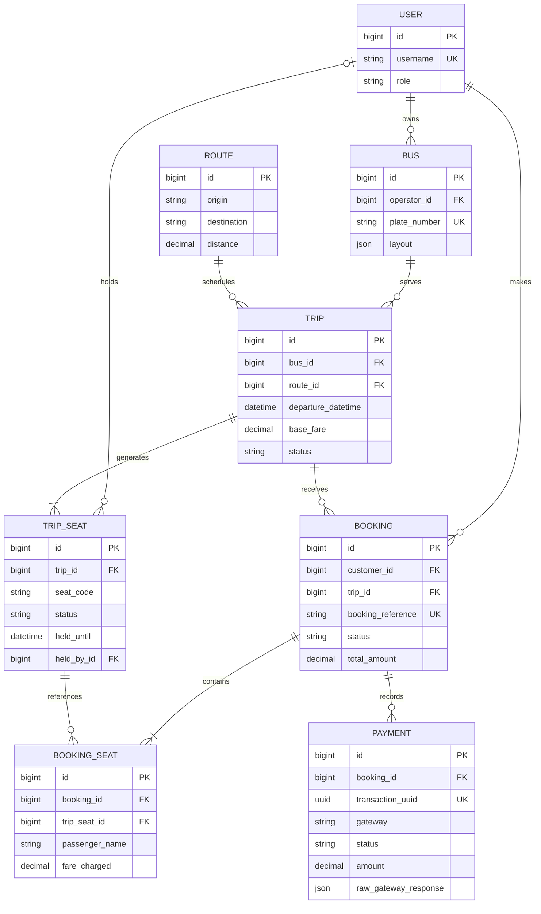

# Sajilo Bus Ticket Booking System

A portfolio-ready bus booking application with a Django REST API and a separate React frontend. Customers can search trips, hold seats safely, pay through the eSewa UAT sandbox, and print QR tickets. Operators manage only their own fleet and schedules, while administrators see system-wide booking analytics.

## Author

Built by [Arman](https://github.com/armancore). View more of my work on [GitHub](https://github.com/armancore).

## Highlights

- PostgreSQL-backed, concurrency-safe 10-minute seat holds
- JSON-driven bus layouts with keyboard-accessible seat selection
- JWT authentication with automatic access-token refresh
- Customer, operator, and administrator permission boundaries
- Live seat polling without Redis, Celery, Channels, or WebSockets
- Server-verified eSewa ePay v2 UAT payments, pay-at-counter reservations, and printable QR tickets
- OpenAPI documentation generated by drf-spectacular

## Project structure

```text
backend/   Django 5 + Django REST Framework API
frontend/  React + Vite single-page application
```

## Requirements

- Python 3.12 or newer
- PostgreSQL
- Node.js 20.19+ or 22.12+

PostgreSQL is required. The seat-hold service uses `SELECT ... FOR UPDATE`, which SQLite cannot provide correctly for this concurrency requirement.

## Fresh-clone setup

### 1. Create the PostgreSQL database

Open `psql` and run:

```sql
CREATE DATABASE bus_ticket;
```

### 2. Configure and run Django

From the project root in PowerShell:

```powershell
python -m venv .venv
.\.venv\Scripts\Activate.ps1
pip install -r backend\requirements.txt
Copy-Item backend\.env.example backend\.env
```

Edit `backend/.env` and set `DB_PASSWORD` to your PostgreSQL password. Then run:

```powershell
cd backend
python manage.py migrate
python manage.py seed_data
python manage.py createsuperuser
python manage.py runserver
```

The API is available at `http://127.0.0.1:8000/api/` and its interactive documentation at `http://127.0.0.1:8000/api/docs/`.

### 3. Run React

Open a second PowerShell window at the project root:

```powershell
cd frontend
npm install
npm run dev
```

Open `http://localhost:5173`. Vite forwards `/api` requests to Django during local development.

## Demo accounts

The repeatable `seed_data` command creates or refreshes:

| Role | Username | Password |
| --- | --- | --- |
| Customer | `demo_customer` | `Customer@12345` |
| Operator | `demo_operator` | `Operator@12345` |

Use the superuser credentials you choose during `createsuperuser` for Django admin. To use that account in the React admin dashboard, set its role to `ADMIN` in Django admin.

## Main application flows

### Customer

1. Search by origin, destination, and date; filters remain in the URL.
2. Open a trip and select seats from its JSON-defined layout.
3. Sign in and hold the seats for 10 minutes.
4. Enter one passenger per seat and continue to the eSewa UAT checkout.
   If the sandbox is unavailable, choose **Book without eSewa** to reserve the seats and pay at the bus counter.
5. Open the confirmed QR ticket from `/bookings` and print it.

### Operator

Sign in at `/login` with the operator demo account. The `/operator` workspace supports owned bus and trip CRUD plus confirmed passenger manifests. Every queryset is filtered by the authenticated operator, so guessing another operator's object ID returns 404.

### Administrator

The `/admin-dashboard` page shows system-wide bookings, confirmed revenue, and occupancy. Full model editing is available at `http://127.0.0.1:8000/admin/`.

## Concurrency design

Seat availability lives directly on each `TripSeat` row. The hold service:

1. Opens `transaction.atomic()`.
2. Locks requested seats with `select_for_update()`, ordered by primary key to avoid multi-seat deadlocks.
3. Treats an expired hold as available and releases it lazily.
4. Rejects the complete request if any seat conflicts.
5. Marks all requested seats held by the customer for 10 minutes.
6. Creates one pending booking and its seat records.

Confirmation locks and rechecks the same records before changing seats to `BOOKED`. A PostgreSQL partial unique constraint on charged `BookingSeat` records is the final database-level double-booking backstop.

## eSewa ePay v2 sandbox

The browser never receives the merchant secret and never calculates a signature or price. Django recomputes the selected-seat fare, creates a fresh payment-attempt UUID, signs the required eSewa fields with HMAC-SHA256, and returns only the form URL and required form fields. React builds a hidden HTML form and submits it as a full-page POST to eSewa.

The success redirect is not trusted as proof of payment. Django extracts only the transaction UUID, calls eSewa's status API independently, checks for `COMPLETE`, compares eSewa's amount with the current server-computed fare, and then locks and sells the seats inside one database transaction.

UAT test wallet credentials:

| Setting | Value |
| --- | --- |
| eSewa IDs | `9806800001` through `9806800005` |
| Password | `Nepal@123` |
| MPIN | `1122` |
| OTP | `123456` |

Payment configuration is read only by Django:

```text
ESEWA_PRODUCT_CODE=EPAYTEST
ESEWA_SECRET=8gBm/:&EnhH.1/q
ESEWA_FORM_URL=https://rc-epay.esewa.com.np/api/epay/main/v2/form
ESEWA_STATUS_URL=https://rc.esewa.com.np/api/epay/transaction/status/
ESEWA_SUCCESS_URL=http://127.0.0.1:8000/api/payments/esewa/success/
ESEWA_FAILURE_URL=http://127.0.0.1:8000/api/payments/esewa/failure/
FRONTEND_BASE_URL=http://localhost:5173
BOOKING_HOLD_MINUTES=10
```

To switch to production, replace the eSewa URLs, product code, secret, and public callback/frontend URLs in the environment. No source-code change is required. Never place these merchant settings in a Vite environment file.

Run lazy hold cleanup and payment reconciliation manually with:

```powershell
python manage.py expire_holds
python manage.py reconcile_esewa
```

`reconcile_esewa` checks attempts that remain initiated or pending for more than five minutes. In a hosted environment it should run on a schedule such as cron.

## Deploying to Render

[`render.yaml`](render.yaml) describes the app as a Render Blueprint. PostgreSQL is hosted separately on Supabase, and every Render service uses the free plan.

| Resource | Render type | Purpose |
| --- | --- | --- |
| `sajilo-bus-api` | Python web service (free) | Django API, admin, and Swagger via Gunicorn and WhiteNoise |
| `sajilo-bus` | Static site | React build; proxies `/api/*` to the API so the browser stays same-origin |

1. Create a Supabase project in the **Southeast Asia (Singapore)** region and save the database password.
2. In Supabase, click **Connect** and copy the **Session pooler** connection string. Render cannot reach Supabase's direct connection, which is IPv6-only. Fill in the password, URL-encoding any special characters (`@` becomes `%40`), and append `?sslmode=require`:

   ```text
   postgres://postgres.<project-ref>:<password>@aws-0-ap-southeast-1.pooler.supabase.com:5432/postgres?sslmode=require
   ```

3. In Render, choose **New > Blueprint**, select the repository, and paste the Supabase URL when asked for `DATABASE_URL` on `sajilo-bus-api`.
4. If Render gives a service a different URL than its name (for example `sajilo-bus-a1b2.onrender.com`), update the values marked `URL` in `render.yaml` and redeploy, or edit them in the `sajilo-bus-backend` environment group and the static site's redirects/rewrites.
5. In GitHub, add the same URL as the repository secret `DATABASE_URL` (**Settings > Secrets and variables > Actions**). The [Maintenance workflow](.github/workflows/maintenance.yml) then runs `expire_holds` and `reconcile_esewa` every ten minutes for free.
6. Open the API service's **Shell** and create an administrator, and optionally demo data:

   ```bash
   python manage.py createsuperuser
   python manage.py seed_data
   ```

The site is served from `https://sajilo-bus.onrender.com`. The Django admin and API docs are at `https://sajilo-bus-api.onrender.com/admin/` and `/api/docs/`.

Free-plan notes: the API sleeps after 15 idle minutes, so the first request afterwards takes up to a minute, and Supabase pauses a free project after a week without activity; restore it from the Supabase dashboard. Migrations run when the API starts because the free plan has no pre-deploy command.

## Data model



The custom user model was created in the first migration, ensuring every later foreign key references the correct authentication table.

## Important API endpoints

```text
POST /api/auth/register/
POST /api/auth/token/
POST /api/auth/token/refresh/
GET  /api/auth/me/

GET  /api/routes/
GET  /api/trips/?origin=Kathmandu&destination=Pokhara&date=YYYY-MM-DD
GET  /api/trips/{id}/
GET  /api/trips/{id}/seats/

POST /api/bookings/hold/
POST /api/bookings/{reference}/passengers/
GET  /api/bookings/
GET  /api/bookings/{reference}/
POST /api/bookings/{reference}/cancel/

POST /api/payments/esewa/initiate/
GET  /api/payments/esewa/success/
GET  /api/payments/esewa/failure/
POST /api/payments/esewa/verify/{transaction_uuid}/

GET, POST          /api/operator/buses/
GET, PATCH, DELETE /api/operator/buses/{id}/
GET, POST          /api/operator/trips/
GET, PATCH, DELETE /api/operator/trips/{id}/
GET                /api/operator/trips/{id}/manifest/
```

## Verification

Run the complete backend checks:

```powershell
cd backend
python manage.py test
python manage.py check
python manage.py makemigrations --check --dry-run
python manage.py spectacular --validate --file schema.yml
```

The suite includes the required threaded concurrency test, lazy hold-expiry tests, database constraint coverage, and role/ownership permission tests.

Run the frontend checks:

```powershell
cd frontend
npm run lint
npm run build
```

## Local-development notes

- Payment uses the eSewa UAT sandbox; Sajilo Bus never collects wallet credentials.
- Holds expire lazily during relevant API reads and writes, so no worker process is needed.
- Seat maps poll every 15 seconds while customers select seats.
- A trip's bus cannot change after creation because its fixed seat inventory has already been generated.
- Buses with trips and trips with booking history use protected deletion rules.

## Payment flow in plain English

1. The customer clicks **Pay with eSewa** while the seat countdown is active.
2. React first sends the passenger names to Django—never a price.
3. Django locks the booking's seats, confirms the hold is still valid, recalculates the total from its own fare data, and creates a new eSewa payment attempt.
4. Django signs the eSewa fields with the server-only secret. React submits those returned fields through a normal HTML form and the browser moves to eSewa.
5. After the customer completes UAT payment, eSewa redirects to Django. The base64 redirect data only tells Django which attempt to check; it does not prove payment.
6. Django calls eSewa's status API itself. Only `COMPLETE` with the exact server price continues.
7. Inside `transaction.atomic()`, Django locks the seats with `select_for_update()`, marks the attempt paid, confirms the booking, and changes the seats from held to booked.
8. Django redirects the browser to React with only the booking reference. React fetches the confirmed booking and shows the QR ticket link.
