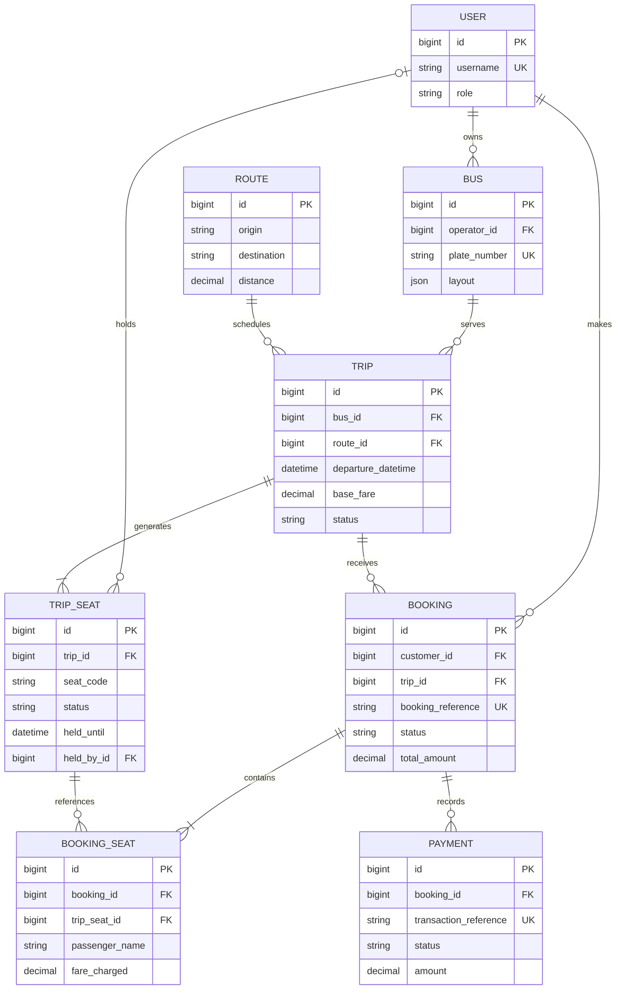

# Sajilo Bus Ticket Booking System

A portfolio-ready bus booking application with a Django REST API and a separate React frontend. Customers can search trips, hold seats safely, confirm mock payments, and print QR tickets. Operators manage only their own fleet and schedules, while administrators see system-wide booking analytics.

## Highlights

- PostgreSQL-backed, concurrency-safe 10-minute seat holds
- JSON-driven bus layouts with keyboard-accessible seat selection
- JWT authentication with automatic access-token refresh
- Customer, operator, and administrator permission boundaries
- Live seat polling without Redis, Celery, Channels, or WebSockets
- Mock payment confirmation and printable QR tickets
- OpenAPI documentation generated by drf-spectacular

## Project structure

```text
backend/   Django 5 + Django REST Framework API
frontend/  React + Vite single-page application
```

## Requirements

- Python 3.12 or newer
- PostgreSQL
- Node.js 20.19+ or 22.12+

PostgreSQL is required. The seat-hold service uses `SELECT ... FOR UPDATE`, which SQLite cannot provide correctly for this concurrency requirement.

## Fresh-clone setup

### 1. Create the PostgreSQL database

Open `psql` and run:

```sql
CREATE DATABASE bus_ticket;
```

### 2. Configure and run Django

From the project root in PowerShell:

```powershell
python -m venv .venv
.\.venv\Scripts\Activate.ps1
pip install -r backend\requirements.txt
Copy-Item backend\.env.example backend\.env
```

Edit `backend/.env` and set `DB_PASSWORD` to your PostgreSQL password. Then run:

```powershell
cd backend
python manage.py migrate
python manage.py seed_data
python manage.py createsuperuser
python manage.py runserver
```

The API is available at `http://127.0.0.1:8000/api/` and its interactive documentation at `http://127.0.0.1:8000/api/docs/`.

### 3. Run React

Open a second PowerShell window at the project root:

```powershell
cd frontend
npm install
npm run dev
```

Open `http://localhost:5173`. Vite forwards `/api` requests to Django during local development.

## Demo accounts

The repeatable `seed_data` command creates or refreshes:

| Role | Username | Password |
| --- | --- | --- |
| Customer | `demo_customer` | `Customer@12345` |
| Operator | `demo_operator` | `Operator@12345` |

Use the superuser credentials you choose during `createsuperuser` for Django admin. To use that account in the React admin dashboard, set its role to `ADMIN` in Django admin.

## Main application flows

### Customer

1. Search by origin, destination, and date; filters remain in the URL.
2. Open a trip and select seats from its JSON-defined layout.
3. Sign in and hold the seats for 10 minutes.
4. Enter one passenger per seat and complete the mock payment.
5. Open the confirmed QR ticket from `/bookings` and print it.

### Operator

Sign in at `/login` with the operator demo account. The `/operator` workspace supports owned bus and trip CRUD plus confirmed passenger manifests. Every queryset is filtered by the authenticated operator, so guessing another operator's object ID returns 404.

### Administrator

The `/admin-dashboard` page shows system-wide bookings, confirmed revenue, and occupancy. Full model editing is available at `http://127.0.0.1:8000/admin/`.

## Concurrency design

Seat availability lives directly on each `TripSeat` row. The hold service:

1. Opens `transaction.atomic()`.
2. Locks requested seats with `select_for_update()`, ordered by primary key to avoid multi-seat deadlocks.
3. Treats an expired hold as available and releases it lazily.
4. Rejects the complete request if any seat conflicts.
5. Marks all requested seats held by the customer for 10 minutes.
6. Creates one pending booking and its seat records.

Confirmation locks and rechecks the same records before changing seats to `BOOKED`. A PostgreSQL partial unique constraint on charged `BookingSeat` records is the final database-level double-booking backstop.

## Data model



The custom user model was created in the first migration, ensuring every later foreign key references the correct authentication table.

## Important API endpoints

```text
POST /api/auth/register/
POST /api/auth/token/
POST /api/auth/token/refresh/
GET  /api/auth/me/

GET  /api/routes/
GET  /api/trips/?origin=Kathmandu&destination=Pokhara&date=YYYY-MM-DD
GET  /api/trips/{id}/
GET  /api/trips/{id}/seats/

POST /api/bookings/hold/
POST /api/bookings/{reference}/confirm/
GET  /api/bookings/
GET  /api/bookings/{reference}/
POST /api/bookings/{reference}/cancel/

GET, POST          /api/operator/buses/
GET, PATCH, DELETE /api/operator/buses/{id}/
GET, POST          /api/operator/trips/
GET, PATCH, DELETE /api/operator/trips/{id}/
GET                /api/operator/trips/{id}/manifest/
```

## Verification

Run the complete backend checks:

```powershell
cd backend
python manage.py test
python manage.py check
python manage.py makemigrations --check --dry-run
python manage.py spectacular --validate --file schema.yml
```

The suite includes the required threaded concurrency test, lazy hold-expiry tests, database constraint coverage, and role/ownership permission tests.

Run the frontend checks:

```powershell
cd frontend
npm run lint
npm run build
```

## Local-development notes

- Payment is intentionally mocked; no card details are collected.
- Holds expire lazily during relevant API reads and writes, so no worker process is needed.
- Seat maps poll every 15 seconds while customers select seats.
- A trip's bus cannot change after creation because its fixed seat inventory has already been generated.
- Buses with trips and trips with booking history use protected deletion rules.
